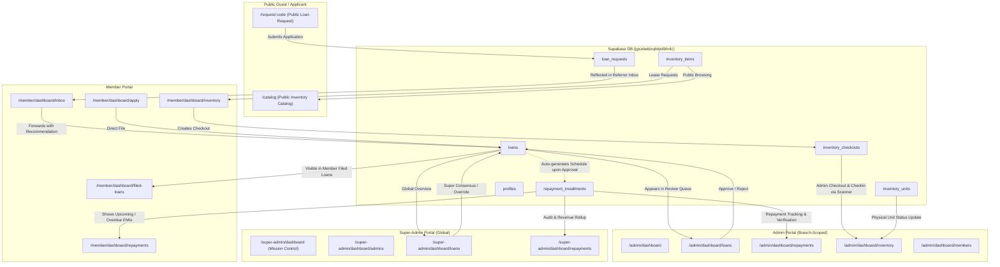

# SKSSF Portal — Integration & Cross-Role Data Flow Map
**Audit Date:** 2026-10-31  
**Auditor:** Antigravity  

---

## 1. System Integration Map

---

## 2. Cross-Role Workflows

### 2.1 Loan Application to Disbursement
1. **Initiation:** Applicant applies via public referral link or Member submits via `/member/dashboard/apply`.
2. **Database:** Row created in `loans` (`workflow_status: 'PENDING_COORDINATOR_REVIEW'`).
3. **Admin/Coordinator Review:** Appears in `/admin/dashboard/loans` and `/coordinator/dashboard/loans`.
4. **Approval:** Admin approves -> `workflow_status` transitions to `APPROVED`.
5. **Schedule Generation:** Repayment installments populated into `repayment_installments` table and mapped in `loans.repayments`.
6. **Member View:** Updated in `/member/dashboard/filed-loans` and scheduled in `/member/dashboard/repayments`.

### 2.2 Repayment Lifecycle
1. **Installment Due:** Alert runner triggers reminder; displayed on Member dashboard and `/member/dashboard/repayments`.
2. **Payment Recording:** Member submits proof/payment via `/api/record-member-repayment` -> updates `repayment_installments` and `loan_audit_log`.
3. **Verification:** Admin approves installment at `/admin/dashboard/repayments`.
4. **Closing:** When all installments are `PAID`, loan auto-closes (`workflow_status: 'REPAYMENT_COMPLETE'`).

### 2.3 Inventory Flow
1. **Catalog Master:** `inventory_items` and `inventory_units` stored in Supabase.
2. **Member Checkout:** Member selects item -> creates record in `inventory_checkouts` (`status: 'active'`).
3. **Admin Action:** Admin uses barcode scanner in `/admin/dashboard/inventory` to verify and return items.
4. **Stock Update:** Item returned -> updates `inventory_units.status` to `'available'` and increments `inventory_items.available_stock`.
