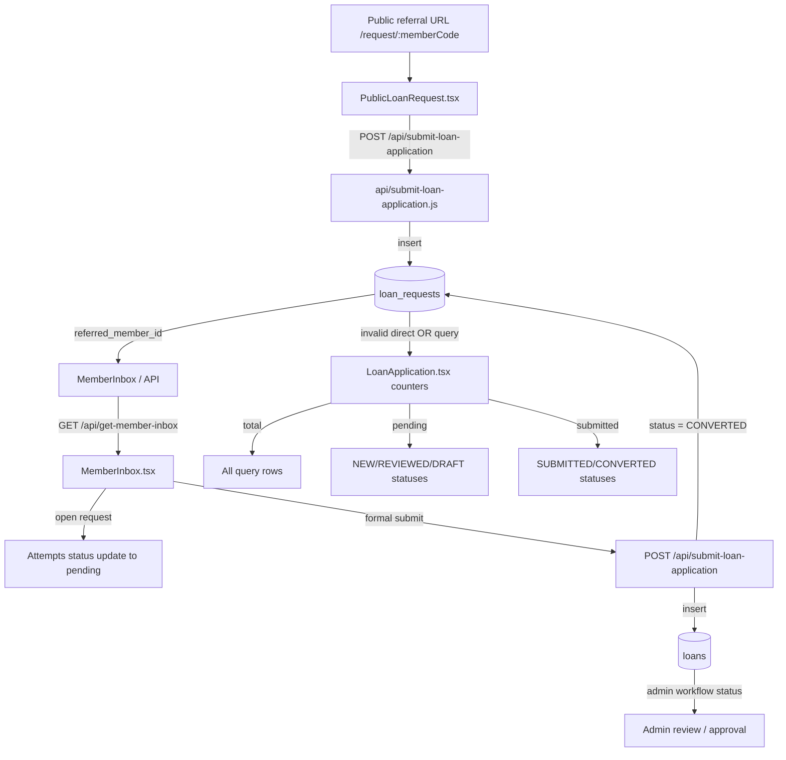

# Member Apply Dashboard Dynamic Data Audit

**Target:** `https://skssf-portal.vercel.app/member/dashboard/apply`  
**Repository:** `Anas-Shareef/SKSSF-Portal`  
**Supabase project:** `jgxzdwbixqhkjrdbhnlc`  
**Audit date:** 2026-11-01  
**Scope:** Read-only source, live-schema, authenticated-production inspection. No production records were inserted or modified.

## Section A — Overall result

### Classification: **Dynamic but Incorrect**

The three values are held in React state and are intended to come from a live Supabase query. They are not hardcoded, localStorage-backed, or `localDb`-backed. However, the production query is invalid because it references `loan_requests.member_id`, a column that does not exist in the live table:

```text
HTTP 400
{"code":"42703","message":"column loan_requests.member_id does not exist"}
```

The error is caught and only logged. The cards remain at their initial zero values, so the page currently displays `0 / 0 / 0` even though the member inbox has live records.

There are additional workflow inconsistencies:

- The counter query uses `member_id OR referred_member_id`; the public-referral writer only sets `referred_member_id`.
- The live `loan_requests` table has no `member_id` column.
- The inbox uses a privileged API with ID, name, and free-text `reason` matching, while the Apply counters use a direct Supabase query.
- The inbox currently shows two requests for Rizwan, but the authoritative referral-ID count is one; the second record has no referral ID and is only matched by text.
- `Total Applications Received` counts every matching request regardless of status.
- `Submitted to Admin` is based on `loan_requests.status IN ('SUBMITTED','CONVERTED')`; it does not count submitted `loans` directly.
- There are three approved `loans` for the test member, but none has `source_request_id`, so those loans do not contribute to the counter.

No code or database fix was implemented in this audit, as requested.

## Section B — Counter-by-counter findings

### 1. Total Applications Received

| Field | Finding |
|---|---|
| Display label | `Total Applications Received` |
| Source file | `src/pages/dashboard/LoanApplication.tsx:117-119` |
| State | `stats.totalReceived`, initialized to `0` at lines 17-21 |
| Fetch function | `loadLinkStats(memberId)` at lines 36-57 |
| Database table | `public.loan_requests` |
| Query | `select id,status where member_id = member UUID OR referred_member_id = member UUID` — see exact query below |
| Ownership filter | Intended `member_id = member UUID OR referred_member_id = member UUID` |
| Status conditions | None; all matching statuses are included, including dismissed/rejected/converted/draft records |
| Duplicates | No `distinct`, deduplication, or source/loan reconciliation |
| Public referrals | Intended to include `referred_member_id`; records matched only by name/reason are not included by this counter |
| Data type | Live React state; not localStorage or `localDb` |
| Refresh behavior | Fetches when `profile` changes/mounts; no realtime subscription; no explicit refetch on tab focus or session refresh |
| Result | **Incorrect in production** |

Exact source query (`LoanApplication.tsx:38-41`):

```ts
const { data, error } = await supabase
  .from('loan_requests')
  .select('id, status')
  .or(`member_id.eq.${memberId},referred_member_id.eq.${memberId}`);
```

Production result: `400 / 42703` because `member_id` is absent. The catch at lines 54-56 logs the error and leaves `stats.totalReceived` at `0`.

### 2. Pending in Inbox

| Field | Finding |
|---|---|
| Display label | `Pending in Inbox` |
| Source file | `src/pages/dashboard/LoanApplication.tsx:121-123` |
| Calculation | `(data || []).filter(r => r.status === 'NEW' || r.status === 'REVIEWED' || r.status === 'DRAFT_UNASSIGNED' || r.status === 'DRAFT').length` at lines 45-47 |
| Database table | Intended `public.loan_requests` |
| Ownership filter | Same invalid `member_id OR referred_member_id` query as Total |
| Included statuses | `NEW`, `REVIEWED`, `DRAFT_UNASSIGNED`, `DRAFT` |
| Excluded statuses | `SUBMITTED`, `CONVERTED`, `DISMISSED`, `pending`, and any future value not listed |
| Inbox list query | **Different**: `/api/get-member-inbox` (privileged server query) with ID/name/reason matching |
| Data type | Live intended; currently zero after swallowed query error |
| Refresh behavior | Same mount/profile-only behavior |
| Result | **Incorrect / can disagree with inbox** |

The inbox normalizer in `src/pages/dashboard/MemberInbox.tsx:72-77` maps `DRAFT_UNASSIGNED`, `DRAFT`, and `pending` to `NEW`, and `CONVERTED`, `forwarded`, and `SUBMITTED` to `SUBMITTED`. Therefore the Apply counter and inbox do not share a single status-normalization function.

The inbox list is loaded at `MemberInbox.tsx:32-95`:

1. It calls `GET /api/get-member-inbox` with a fresh access token.
2. `api/get-member-inbox.js:46-49` reads all `loan_requests` with the service role.
3. `api/get-member-inbox.js:53-64` filters by `member_id || referred_member_id || referred_id`, referred name, or free-text reason.

That API currently returns two requests for the test member, while the Apply counter query fails. Even after repairing the counter query to use only `referred_member_id`, it would count one authoritative referral-ID row, not the second free-text-matched row.

### 3. Submitted to Admin

| Field | Finding |
|---|---|
| Display label | `Submitted to Admin` |
| Source file | `src/pages/dashboard/LoanApplication.tsx:125-127` |
| Calculation | `status === 'SUBMITTED' || status === 'CONVERTED'` at lines 46-47 |
| Database table | `public.loan_requests` |
| Ownership filter | Same invalid `member_id OR referred_member_id` query |
| Business event assumed | Request status becomes `SUBMITTED` or `CONVERTED` |
| Actual member-submit event | `MemberInbox.tsx:144-160` calls `/api/submit-loan-application`; the endpoint creates a `loans` row and updates the source `loan_requests.status` to `CONVERTED` at `api/submit-loan-application.js:208-217` |
| Admin review required? | No. `CONVERTED` is set when the member submits; admin approval is represented separately on `loans.status` / `loans.workflow_status` |
| Duplicate protection | No counter deduplication; one request row is counted once, but request-to-loan reconciliation is not enforced by the counter |
| Data type | Live intended; currently zero after swallowed query error |
| Refresh behavior | Mount/profile-only; no realtime |
| Result | **Dynamic but semantically narrow and currently broken** |

The label means “the request was converted into a loan submission,” not “an administrator approved it.” An approved loan can exist without contributing to this counter when `source_request_id` is null. Conversely, a `CONVERTED` request is counted even before admin approval.

## Section C — Data flow



## Section D — Actual database evidence

### Live schema probes

Service-role read-only probes against PostgREST showed:

- `loan_requests` includes: `id`, `requester_name`, `requester_phone`, `requester_address`, `reason`, `approximate_amount`, `referred_member_name`, `referred_member_id`, `status`, `converted_to_loan_id`, `dismissal_reason`, `dismissed_by`, `created_at`, and the applicant/detail fields added by migration 014.
- `loan_requests.member_id` does **not** exist. Selecting or filtering it returns `42703`.
- `loans.submitted_by_member_id` exists and is the ownership field used by the current loan/RLS workflow.

### Aggregate counts (safe; no private applicant data included)

For member UUID `0bb52e0c-4a26-42de-af84-f48663a22016`:

```text
loan_requests total rows: 2
loan_requests status totals: { DRAFT_UNASSIGNED: 2 }
rows with referred_member_id = test member: 1
those referral-ID rows by status: { DRAFT_UNASSIGNED: 1 }
those referral-ID rows converted_to_loan_id != null: 0

loans submitted_by_member_id = test member: 3
loan statuses: { approved: 3 }
loan workflow_statuses: { APPROVED: 3 }
those loans with source_request_id != null: 0
```

The live authenticated browser test showed:

```text
Apply page cards: Total 0, Pending 0, Submitted 0
Counter request: HTTP 400, PostgreSQL 42703, loan_requests.member_id does not exist

Inbox API: HTTP 200
Inbox display: All (2), New (2), Submitted to Admin (0), Dismissed (0)
```

The authenticated direct query using only the existing referral column returned one row for Rizwan and zero rows when Rizwan queried Navas’s referral ID. This confirms that the database query is member-scoped when it uses the real `referred_member_id` relationship; no other member’s row was exposed in that check.

### RLS / authorization observation

The repository migration `supabase/migrations/20261031_security_and_rls_hardening.sql:93-107` defines a member policy using `member_id = auth.uid()`, but `member_id` is absent from the live table. That migration definition is inconsistent with the deployed schema and cannot be the reliable ownership mechanism for referral rows as written.

The inbox endpoint is authenticated but uses the service role and performs application-side filtering (`api/get-member-inbox.js:44-67`). It is therefore important that its matching rule use a real, authoritative relationship rather than free-text `reason` or display name.

## Section E — Problems found

1. **Production counter query is invalid.** `LoanApplication.tsx:41` references nonexistent `loan_requests.member_id`, producing `42703`.
2. **The error is swallowed.** `LoanApplication.tsx:54-56` does not expose an error state, so all three cards silently remain zero.
3. **Counter and inbox use different sources.** Counters use direct Supabase; inbox uses `/api/get-member-inbox` with service-role filtering.
4. **Ownership is not consistently modeled.** Public referral inserts use `referred_member_id`; the counter also references nonexistent `member_id`; the inbox additionally trusts name/reason text.
5. **Live data mismatch.** The test member has one referral-ID request and three approved submitted loans, while the inbox displays two requests due to a second row being text-matched.
6. **Pending status logic is duplicated.** The Apply page and inbox have separate status normalization/filters.
7. **Review transition is incorrect.** `MemberInbox.tsx:107-115` attempts to set a new request to `pending`, while the repository status constraint in migration 014 permits `DRAFT`, `DRAFT_UNASSIGNED`, `REVIEWED`, `SUBMITTED`, `CONVERTED`, and `DISMISSED`, not `pending`. The error is ignored, so opening a request does not reliably mark it reviewed.
8. **Submitted counter does not mean approved.** It counts `CONVERTED` requests, while admin approval is stored on `loans.status` / `loans.workflow_status`.
9. **No deduplication or request-to-loan reconciliation.** Counters count request rows; they do not ensure one application/request is represented once across `loan_requests` and `loans`.
10. **No automatic live updates.** There is no realtime subscription, polling, tab-focus refresh, or `appDataUpdated` listener in `LoanApplication.tsx`.
11. **No loading/error state for cards.** Initial zeros are indistinguishable from real zero counts.
12. **Local storage is not the cause.** `LoanApplication.tsx` does not use `localDb` or localStorage for these counters; the failure is schema/query/workflow related.

## Section F — Recommended fixes (not implemented)

1. **Fix the authoritative ownership query** in `src/pages/dashboard/LoanApplication.tsx`:
   - Remove `member_id` from the query because it is not a live column.
   - Query by `referred_member_id = auth.uid()` for public referral applications.
   - Do not use applicant name or free-text reason as authorization criteria.
2. **Align the inbox and counters**:
   - Either expose one authenticated backend endpoint returning both request rows and aggregate counts, or share one canonical Supabase query/status-normalization helper.
   - Make the counter and inbox use the same ownership field and status mapping.
3. **Define counter semantics explicitly**:
   - Total: referral request rows owned by the member, with a documented treatment of dismissed/converted rows.
   - Pending: only actionable request statuses, likely `DRAFT_UNASSIGNED`/`REVIEWED` according to product rules.
   - Submitted: requests whose conversion event created/linked a loan, preferably using `converted_to_loan_id` or a validated `source_request_id` relationship.
4. **Repair the review transition** in `src/pages/dashboard/MemberInbox.tsx` to write the actual permitted `REVIEWED` status and handle/report update errors.
5. **Harden `api/get-member-inbox.js`** to filter only by the authoritative `referred_member_id` relationship. Remove fallback matching by `referred_member_name` and free-text `reason` for authorization.
6. **Reconcile schema/RLS migration** in a separately reviewed database change. Do not add `member_id` merely to silence the query; first decide whether `referred_member_id` is the intended owner field, then make the policy and application use that existing relationship consistently.
7. **Add explicit loading/error states** to `LoanApplication.tsx`; never leave zero-valued cards after a failed query.
8. **Add refresh behavior** after inbox actions, on page visibility/focus, and/or via Supabase realtime if live updates are required.
9. **Add read-only tests** for: one referral, reviewed request, converted request, dismissed request, missing referral ID, cross-member access, and request/loan linkage.

## Final conclusion

The counters are **intended to be dynamic**, but in production they are currently **incorrect**: the live query fails on a nonexistent column and the UI silently reports zeros. The inbox is a separate, more permissive service-role path and currently disagrees with the Apply cards. The public referral flow writes `referred_member_id` correctly in its primary API path, but the deployed counter and RLS definitions are not aligned with that real schema. Fixing the ownership relationship and unifying the query/status semantics is required before the counters can be considered accurate.
